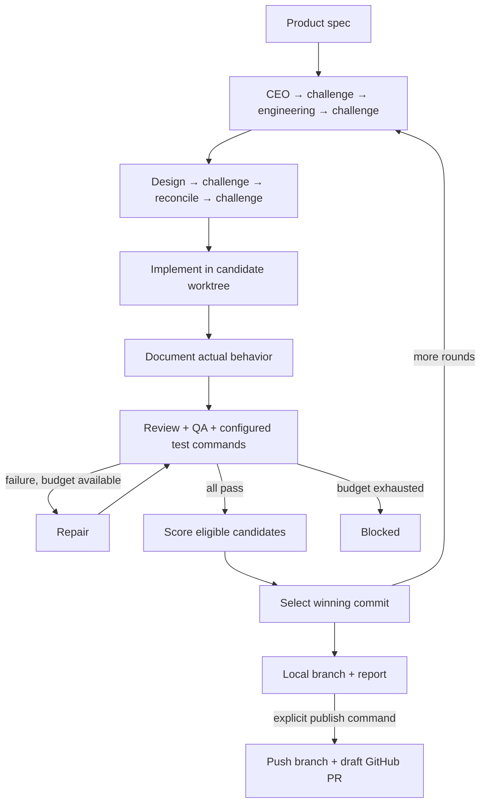

# gstack-codex-auto

[](https://github.com/f-tiger/gstack-codex-auto/actions/workflows/ci.yml)
[中文说明](README.zh-CN.md) · [Validation](docs/validation.md) · [Security](SECURITY.md)

The v0.1.1 update includes [two adversarial review passes](docs/adversarial-review.md), with regression tests and explicit limitations.

Turn a product spec into a reviewed, tested Git branch through a bounded **Codex CLI** pipeline. Inspired by the workflow in [gstack-auto](https://github.com/loperanger7/gstack-auto); this is an original implementation with no Claude runtime dependency.

**Experimental v0.1.1.** Offline controller tests and a simulated CLI integration test cover the workflow. A live Codex smoke attempt during release preparation was rejected with HTTP 401. A real model end-to-end run has **not** been validated. See [the validation record](docs/validation.md).

## What it does

The controller runs 13 phase roles in fresh Codex sessions, reuses locally installed [gstack](https://github.com/garrytan/gstack) skills, and handles retries and Git worktrees itself.



- **Multiple candidates and rounds:** separate worktrees, bounded parallelism, next round starts from the previous winning commit.
- **Evidence before selection:** review, QA and configured command exit codes must all pass. A high model score cannot override a failed check.
- **Repair loop:** challenges can request plan revisions; failed final checks trigger code repair and rechecking.
- **Resume:** atomic checkpoints, artifact hashes, source fingerprints and exclusive run locks. Completed phases are reused; stale final reviews are rerun.
- **Bounded execution:** invocation count, subprocess timeouts, repair count and a `STOP` file.
- **Explicit publishing:** `run` produces local branches; `publish` pushes the exact winning commit and opens a draft PR.

This automates the core spec → planning → implementation → review → QA → repair → documentation → delivery flow. It does **not** execute every optional gstack utility. Interactive `/office-hours`, a web dashboard, email, deployment and automatic merging are outside v0.1.1. A spec is the input. Independent sessions of the same Codex model are **not cross-model review**, and candidate selection is **not reinforcement learning**.

## Install

Requires **Python 3.11+**, Git, an installed/authenticated [Codex CLI](https://developers.openai.com/codex/cli/), and Linux, macOS or WSL. Native Windows is not supported. GitHub CLI is only needed for `publish`. The Python package has no runtime dependencies.

```bash
pipx install 'git+https://github.com/f-tiger/gstack-codex-auto.git@v0.1.1'
gstack-codex-auto --version
```

Or use a virtual environment:

```bash
git clone https://github.com/f-tiger/gstack-codex-auto.git
cd gstack-codex-auto
python3 -m venv .venv
.venv/bin/python -m pip install .
.venv/bin/gstack-codex-auto --help
```

For the default `gstack` mode, first install upstream's Codex support following its instructions, for example `./setup --host codex` from a gstack checkout. GCA looks for `gstack-*/SKILL.md` in `${CODEX_HOME:-~/.codex}/skills`, or your configured `skills_dir`. It requires `plan-ceo-review`, `plan-eng-review`, `plan-design-review`, `review`, `qa`, `document-release` and `retro`. Newer gstack releases ship the engineering methodology as `gstack-autoplan/plan-eng-review.md`; GCA supports that layout as well as the older standalone skill. Third-party skills and binaries are **not bundled**. Keep the installation unchanged during a run.

`"skill_mode": "builtin"` explicitly uses this project's original role briefs without upstream skills. Missing gstack skills never silently select that mode.

## Run on an existing project

1. Write a concrete `SPEC.md` with acceptance criteria, constraints and required runtime evidence. See [the example spec](examples/SPEC.md).
2. Add `gca.json` in the target repository. The gate must be a real test command for your project; a placeholder such as `true` provides no useful evidence.

```json
{
  "repo": ".",
  "spec": "SPEC.md",
  "skill_mode": "gstack",
  "candidates": 2,
  "parallel": 2,
  "rounds": 1,
  "max_fixes": 2,
  "max_calls": 60,
  "timeout": 1200,
  "gate_timeout": 300,
  "gates": [["npm", "test", "--", "--runInBand"]]
}
```

3. Commit or stash existing changes, including the config/spec if placed inside the repository. Start from a clean Git repository with at least one commit. Dependencies must already be available in each worktree; see below.
4. Inspect the plan, then execute. Choose a **new state directory outside the target repository**.

```bash
gstack-codex-auto doctor --config gca.json
gstack-codex-auto plan --config gca.json
gstack-codex-auto run --config gca.json --run-dir ../gca-runs/feature-001
gstack-codex-auto report ../gca-runs/feature-001
```

`doctor` checks configuration, skill files and the executable. It makes no paid model call and does **not** certify authentication or browser availability. Check your CLI login with a small live invocation before a large run. A normal successful candidate uses 13 Codex calls; repairs and planning revisions cost more. `max_calls` is shared across all rounds/candidates and includes failed invocations. It is **not** a token or monetary cap.

All phases use `codex exec --ephemeral --output-schema ... --output-last-message ...`, with `approval_policy="never"`. Planning/review/QA/scoring request `read-only`; implementation, documentation and repair request `workspace-write`. No dangerous sandbox bypass flag is used. Tool access still depends on your installed Codex configuration and host restrictions. Missing required browser/runtime evidence must be reported as blocked.

### Configuration

Paths for `repo`, `spec` and `skills_dir` resolve relative to the config file. `codex` is an executable name on PATH or an absolute path.

| Key | Default | Meaning |
| --- | --- | --- |
| `repo`, `spec` | `.`, `SPEC.md` | Target repository and task spec |
| `skill_mode` | `gstack` | `gstack` or explicit `builtin` |
| `skills_dir` | Codex skills directory | Directory containing `gstack-*` |
| `codex`, `model` | `codex`, CLI default | Executable and optional model name |
| `candidates`, `parallel` | `1`, `1` | 1–8 candidates, 1–8 worker threads |
| `rounds` | `1` | 1–10 sequential rounds |
| `max_fixes` | `2` | 0–5 revisions per challenge and final repair attempts |
| `max_calls` | `100` | 1–2000 total Codex subprocess starts |
| `timeout`, `gate_timeout` | `1200`, `300` | Seconds per Codex call / per gate |
| `gates` | required | Nonempty list of argv arrays |

Commands are passed as argv, without shell expansion. There is no interpolation of `$HOME`, `~`, pipes or `&&` in gates. Gates run from the candidate worktree under your current account. Use absolute paths for an external acceptance harness or prebuilt environment. Test/build outputs must be Git-ignored; gates that change tracked or non-ignored source invalidate the candidate. Do not install dependencies or rewrite lockfiles inside a verification gate.

Git worktrees do not copy ignored dependencies such as `node_modules` or `.venv`. Provision an external environment, a read-only dependency cache, or project-specific setup available to Codex before running. The controller does not run a dependency installer. Agent commands remain subject to the configured sandbox; local HTTP/browser access may require host setup.

## Resume, stop and inspect

```bash
gstack-codex-auto status ../gca-runs/feature-001
gstack-codex-auto resume ../gca-runs/feature-001
touch ../gca-runs/feature-001/STOP
```

`STOP` prevents subsequent phases/gates/candidates from being scheduled. It does not cancel an already running subprocess; that process keeps its configured timeout. Remove `STOP` to resume. Ctrl+C propagates cancellation to active Codex/gate processes. Commands cannot leave background processes in their original process group; provision any persistent server separately. Interrupted write phases can leave partial changes, which the resumed phase sees, but their HEAD/branch must remain unchanged. An interruption during a controller commit may require a new run rather than guessing whether that commit was verified. Do not manually edit candidate worktrees while a run is active or interrupted. Integrity violations require inspection and a new run. A consumed invocation budget is never reset by resume. A blocked model response is retried on resume; successful cached phases are reused subject to evidence checks.

v0.1.1 uses checkpoint schema 2. Earlier run directories are rejected by `resume`/`publish`; start a new run. Submodules, sparse/skip-worktree indexes and assume-unchanged flags are unsupported because they can hide differences between files being tested and the committed tree.

Artifacts live under `round-N/candidate-N/`: prompts, raw Codex events, JSON results, gate logs, checkpoints and the worktree. These contain private code and task data. The state directory is created with mode `0700`; don't publish it. The config/spec are snapshotted. Top-level skill files are hashed; referenced skill documents and binaries are **not** frozen. A candidate winner is chosen by average model score, then fewer repairs, then candidate number. Scores do not establish correctness beyond the configured checks.

The source checkout remains on its original branch. GCA creates shared Git metadata and local `gca/...` branches. All controller Git commands disable hooks, including worktree creation and push. Worktrees are a convenience for separate changes, **not a security boundary**.

## Publish a completed candidate

Review the report and diff, then explicitly publish:

```bash
gstack-codex-auto publish ../gca-runs/feature-001 \
  --github-repo OWNER/REPO --base main --title "Implement feature"
```

The requested GitHub repository must exactly match `origin` and every resolved push URL (HTTPS or standard SSH URL). Publishing holds the run lock and rechecks the winner's committed tree, review/QA/score artifacts and gate receipts. Retain the winner's worktree and artifacts until publication. Implicit tag following is disabled. Repeating the command reuses an existing open PR. It never merges or deploys. Review generated changes for secrets and rerun CI before merging. `status`/`report` display saved state; `resume` and `publish` revalidate final evidence.

## Development

```bash
python3 -m pip install -e .
python3 -m unittest discover -s tests -v
```

Tests use deterministic fixtures, not paid model calls. See [CONTRIBUTING.md](CONTRIBUTING.md) for the acceptance contract and [docs/validation.md](docs/validation.md) for release evidence and limits.

## Attribution and license

MIT for the original code in this repository. The workflow idea is credited to [loperanger7/gstack-auto](https://github.com/loperanger7/gstack-auto) and the role/skill ecosystem to [garrytan/gstack](https://github.com/garrytan/gstack). No source files, prompts, UI assets or third-party binaries from those projects are redistributed here. Third-party components retain their own licenses. This project is not an official gstack or OpenAI release. See [NOTICE](NOTICE).
